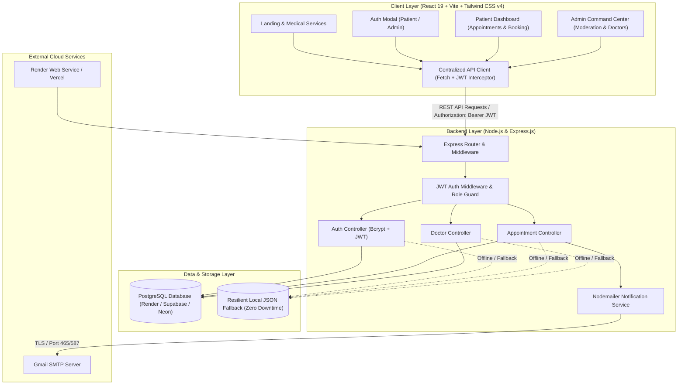
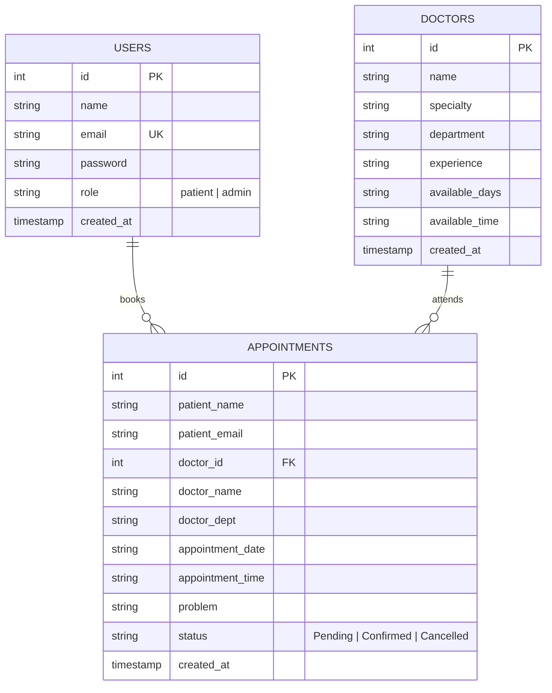
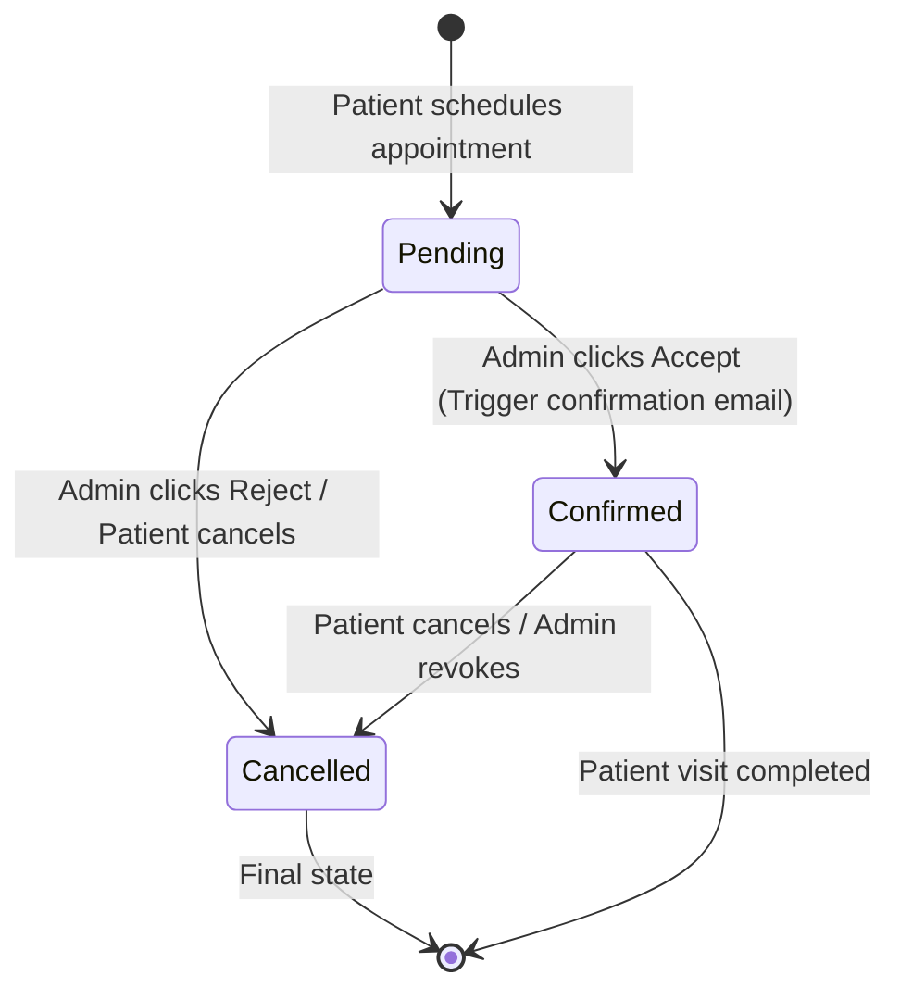
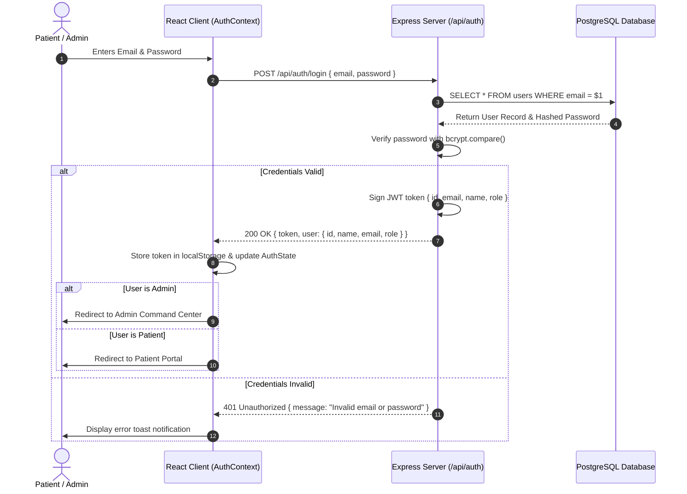

# 🏥 Clinic Appointment Scheduling System — Architectural Blueprint

> **System Version:** 2.0.0  
> **Architecture Pattern:** Modular Fullstack (React SPA + Node.js REST API + PostgreSQL / Resilient JSON Store)  
> **Author & Developer:** [Badhon](https://github.com/badhongit25)  

---

## 1. 🏗️ High-Level System Architecture



---

## 2. 🗄️ Database Schema & Entity Relationships



---

## 3. 🔄 Appointment Booking & Status Lifecycle



---

## 4. 🔐 Authentication & Role-Based Access Flow



---

## 5. 📡 RESTful API Contract Specification

### 🔑 Authentication (`/api/auth`)
| Method | Endpoint | Access | Description | Request Body |
| :--- | :--- | :--- | :--- | :--- |
| `POST` | `/api/auth/register` | Public | Register new patient account | `{ name, email, password }` |
| `POST` | `/api/auth/login` | Public | Authenticate user & get JWT | `{ email, password }` |
| `GET` | `/api/auth/me` | Protected | Fetch current user profile | Header: `Authorization: Bearer <token>` |

### 📅 Appointments (`/api/appointments`)
| Method | Endpoint | Access | Description | Request Body / Query |
| :--- | :--- | :--- | :--- | :--- |
| `POST` | `/api/appointments` | Public / Patient | Book a new medical appointment | `{ patientName, patientEmail, doctorName, doctorDept, date, time, problem }` |
| `GET` | `/api/appointments` | Public / Admin | Fetch appointments (supports `?email=...`) | Query params: `email` (optional) |
| `PATCH`| `/api/appointments/:id/status` | Admin | Update status (`Confirmed`, `Cancelled`) | `{ status: "Confirmed" \| "Cancelled" }` |
| `DELETE`| `/api/appointments/:id` | Admin / Patient | Permanently delete appointment | URL param: `id` |

### 🩺 Doctors (`/api/doctors`)
| Method | Endpoint | Access | Description | Request Body |
| :--- | :--- | :--- | :--- | :--- |
| `GET` | `/api/doctors` | Public | List all active specialists | — |
| `POST` | `/api/doctors` | Admin | Add new specialist to directory | `{ name, specialty, department, experience, available_days, available_time }` |
| `DELETE`| `/api/doctors/:id` | Admin | Remove doctor from system | URL param: `id` |

---

## 6. 📁 Directory Tree Architecture

```
Clinic Appointment Scheduling System/
├── .gitignore                    # Root gitignore (ignores node_modules, dist, .env)
├── package.json                  # Root runner & build orchestration
├── render.yaml                   # Infrastructure-as-code for Render deployment
├── README.md                     # Project documentation & setup instructions
├── BLUEPRINT.md                  # Comprehensive architectural blueprint
│
├── backend/                      # Node.js Express REST API
│   ├── config/
│   │   └── db.js                 # PostgreSQL connection pool & resilient local JSON fallback
│   ├── controllers/
│   │   ├── appointmentController.js # Appointment booking, listing, moderation
│   │   ├── authController.js     # Register, login, JWT issuance
│   │   └── doctorController.js   # Doctor listing, creation, removal
│   ├── middleware/
│   │   └── authMiddleware.js     # JWT verification & requireAdmin guard
│   ├── routes/
│   │   ├── appointmentRoutes.js  # /api/appointments
│   │   ├── authRoutes.js         # /api/auth
│   │   └── doctorRoutes.js       # /api/doctors
│   ├── services/
│   │   └── emailService.js       # Nodemailer HTML email notifications
│   ├── .env.example              # Environment variables template
│   ├── package.json              # Backend dependencies
│   └── server.js                 # Express server & static React SPA handler
│
├── frontend/                     # Modern React SPA (Vite + Tailwind CSS v4)
│   ├── public/                   # Static assets & icons
│   ├── src/
│   │   ├── api/
│   │   │   └── apiClient.js      # Centralized HTTP client
│   │   ├── components/
│   │   │   ├── AuthModal.jsx     # Patient & Admin login/register modal
│   │   │   ├── BookingModal.jsx  # Doctor selection & slot picker modal
│   │   │   ├── Footer.jsx        # Footer with developer credit
│   │   │   └── Navbar.jsx        # Responsive navigation & role indicators
│   │   ├── context/
│   │   │   └── AuthContext.jsx   # Global user state & session management
│   │   ├── views/
│   │   │   ├── AdminDashboard.jsx # Admin KPI cards, moderation table, doctor manager
│   │   │   ├── HomeView.jsx      # Medical hero, departments, doctor cards
│   │   │   └── PatientDashboard.jsx # Patient appointment tracking & cancellations
│   │   ├── App.jsx               # Root React component
│   │   ├── index.css             # Tailwind CSS & theme styling
│   │   └── main.jsx              # React DOM root entry
│   ├── index.html                # HTML5 template with Plus Jakarta Sans
│   ├── package.json              # Frontend dependencies
│   ├── vercel.json               # Vercel SPA routing fallback
│   └── vite.config.js            # Vite configuration with Tailwind CSS plugin & proxy
│
└── legacy_backup/                # Secure archive of initial vanilla HTML/CSS/JS files
```
